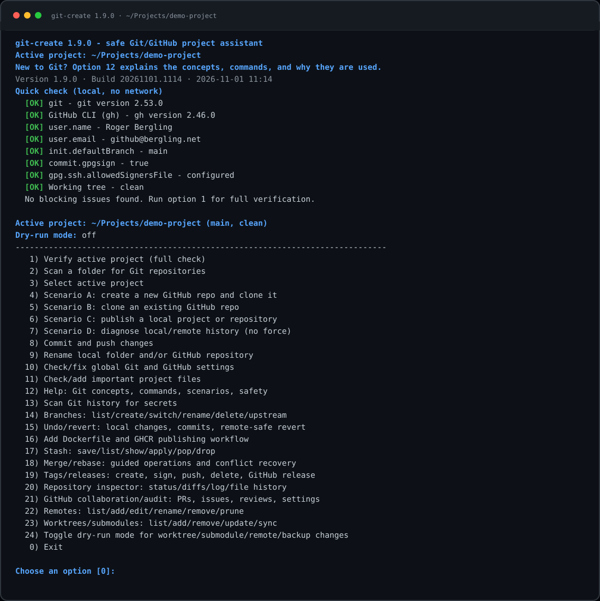
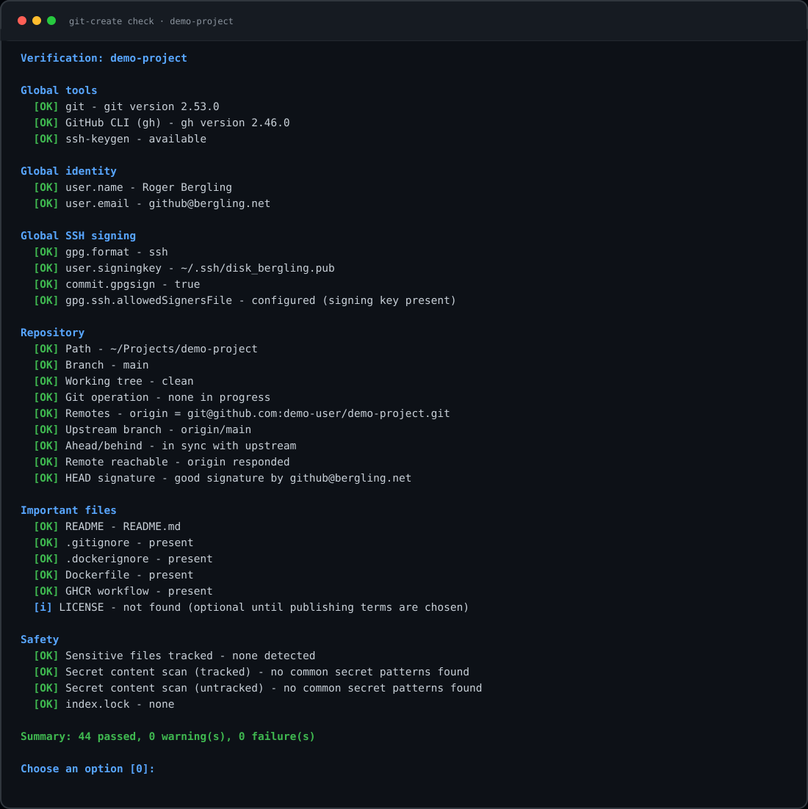
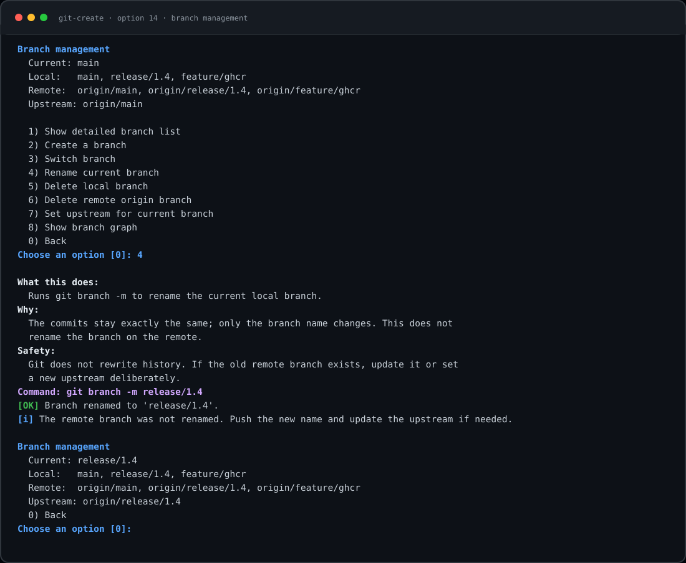

# git-create

A safe, menu-driven Git and GitHub assistant for Linux. It is a **single
Python file with no third-party dependencies**. It helps you create, clone,
publish, verify, rename, branch, undo/revert, containerize, commit, push, and
diagnose projects without missing important Git settings, SSH signing
configuration, secret files, or remote history problems.

Current version: **1.5.0**.

## Contents

- [Why I built this app](#why-i-built-this-app)
- [Why Python instead of a shell script or an ELF?](#why-python-instead-of-a-shell-script-or-an-elf)
- [Requirements](#requirements)
- [Installation](#installation)
- [Quick start](#quick-start)
- [Screenshots](#screenshots)
- [Git in plain English](#git-in-plain-english)
- [What each command does and why](#what-each-command-does-and-why)
- [How the app teaches while you use it](#how-the-app-teaches-while-you-use-it)
- [Menu reference](#menu-reference)
- [Automatic checks on every run](#automatic-checks-on-every-run)
- [Global settings checked](#global-settings-checked)
- [Project files checked](#project-files-checked)
- [Scenarios](#scenarios)
- [Branch management](#branch-management)
- [Undo and revert helpers](#undo-and-revert-helpers)
- [Stash helpers](#stash-helpers)
- [Merge and rebase](#merge-and-rebase)
- [Tags and releases](#tags-and-releases)
- [Repository inspector](#repository-inspector)
- [Batch verification](#batch-verification)
- [GitHub collaboration](#github-collaboration)
- [Remotes](#remotes)
- [Docker image and GHCR workflow](#docker-image-and-ghcr-workflow)
- [Command line mode](#command-line-mode)
- [Safety model](#safety-model)
- [Limitations](#limitations)
- [What the app does not do](#what-the-app-does-not-do)
- [Network access and privacy](#network-access-and-privacy)
- [Updating and uninstalling](#updating-and-uninstalling)
- [Troubleshooting](#troubleshooting)
- [Development and validation](#development-and-validation)
- [Repository layout](#repository-layout)

The app is deliberately conservative:

- no `git push --force`
- no automatic history rewriting
- no automatic merge/rebase of diverged histories
- no overwriting existing project files
- no silent commits containing `.env`, keys, tokens, or other secrets

## Screenshots

### Main menu and startup quick check



### Full verification report



### Branch management with command explanation



The screenshots are illustrative terminal renders of the actual menu and report
layouts. Paths, account names, and results are examples.

## Why I built this app

I built this app because I was learning Git myself and did not want to depend
on memory for every important step. Git is powerful, but a lot of its behavior
is invisible until something goes wrong:

- A project may have no repository, a local repository, a remote repository,
  or both — and each situation needs a different workflow.
- The same action can be harmless or destructive depending on the state of the
  working tree, the branch, and the remote.
- Git identity, SSH signing, the default branch, pull behavior, and GitHub
  authentication are easy to configure once and then forget.
- Secret files such as `.env`, private keys, and tokens can be committed by
  accident if `.gitignore` is missing or incomplete.
- A rejected push is not a reason to use `--force`. It is a signal to compare
  histories first.
- Renaming a folder, renaming a GitHub repository, committing, and pushing are
  related tasks, but Git does not treat them as one operation.

I wanted one menu that checks the things I usually forget, explains what the
next command will do and why, refuses unsafe shortcuts, and keeps the commands
visible so I can learn from them. The app is a checklist, a safety net, and a
teaching tool — not an autopilot that hides Git from me.

That is also why it prints the command before running it and why every major
action has a **What this does** and **Why** explanation. The goal is to make the
safe path the easy path while still learning what Git is doing.

## Why Python instead of a shell script or an ELF?

Python 3 is the best fit for this task:

- A single executable text file works on every Linux distribution without a
  build step.
- The standard library provides reliable subprocess handling, JSON parsing,
  path handling, file scanning, and text formatting.
- Shell would become fragile around JSON, quoting, menus, and secret scanning.
- A compiled ELF would need per-architecture builds, a toolchain, and more
  maintenance for no practical benefit here.

The program targets Python 3.9 or newer. It has been tested with Python 3.14,
Git 2.53, and GitHub CLI 2.46.

## Requirements

Required:

- Linux
- Python 3.9+
- Git 2.34+ for SSH commit signing (`git init -b` needs a slightly older Git,
  but the verification and signing features assume 2.34+)
- OpenSSH client (`ssh`, `ssh-keygen`) for SSH commit signing

Recommended for GitHub scenarios:

- [GitHub CLI](https://cli.github.com/) `gh` 2.x
- An SSH key configured for GitHub authentication and signing

Optional:

- Docker, if you want `.dockerignore` checks to be active
- `ssh-agent`, if your SSH key has a passphrase

No `pip install`, virtual environment, Makefile, or package manager is needed.

## Installation

From this repository, make the app executable:

```bash
chmod +x git-create
```

To copy it somewhere else, use a file path that does not collide with the
repository directory:

```bash
mkdir -p ~/bin
cp git-create ~/bin/git-create
chmod +x ~/bin/git-create
```

To run it as a Git subcommand from any directory, place it on `PATH`:

```bash
mkdir -p ~/.local/bin
ln -s "$(pwd)/git-create" ~/.local/bin/git-create
```

Then both forms work:

```bash
git-create
git create
```

The current working directory is always the source of truth. If you run the
script from a project root, that project is detected automatically. If you run
it from elsewhere, use **option 3** to select a project.

## Quick start

```bash
cd ~/Projects
git-create
```

Typical menu flow:

1. Run the automatic quick check at startup.
2. Choose **1** to run a full verification on the active project.
3. Use **4**, **5**, or **6** to create, clone, or publish a repository.
4. Use **8** for reviewed commits and normal pushes.
5. Use **7** whenever local and remote histories may have diverged.
6. Use **13** before publishing or sharing a repository that may have a secret
   in its history.
7. Use **14** to manage branches, **15** for undo/revert operations, and **16**
   to generate a Dockerfile and GHCR publishing workflow.
8. Use **17** for stashes, **18** for guided merge/rebase, **19** for tags and
   GitHub releases, and **20** to inspect status, diffs, and history.
9. In option **2**, enter `a` after a scan to verify every repository locally.
10. Use **21** for pull requests, issues, and reviews, and **22** to manage
    local remote names and URLs.

The app never changes your global Git configuration or project files without
showing a plan and asking for confirmation. The settings wizard, file templates,
publish flow, and rename flow all require explicit approval before writing.

## Git in plain English

If you are new to Git, these are the concepts the app uses. Read this once;
the in-app help (option **12**) repeats the important parts when you need them.

| Concept | Plain-English meaning |
| --- | --- |
| Working tree | The files you see and edit in the project folder. |
| Repository | The `.git` folder that stores the project's history and configuration. |
| Staging area / index | A waiting room for changes. You choose what goes into the next commit. |
| Commit | A saved, labeled snapshot of the staged changes, with an author, time, message, and optional signature. |
| Branch | A movable name pointing at a line of commits. `main` is the usual default branch. |
| Remote | A named copy of the repository somewhere else, usually GitHub. The default name is `origin`. |
| `origin/main` | Your local record of where the `main` branch was on the remote at the last fetch. |
| Upstream | The remote branch that your current local branch tracks. |
| Fetch | Downloads new remote information without changing your files or branch. |
| Pull (fast-forward) | Moves your branch forward to the remote commit without creating a merge commit. |
| Push | Uploads your local commits to the remote branch. |
| Diverged | Local and remote both have commits the other does not. Do not force; inspect first. |
| Stash | A local saved set of uncommitted changes that is not part of history. |
| Merge | Combines two histories, often creating a merge commit when both sides moved. |
| Rebase | Replays local commits on a new base; rewrites those local commits. |
| Tag | A stable name for one commit, commonly used for versions and releases. |
| Release | GitHub metadata, notes, and optional assets attached to a tag. |
| Commit signing | A cryptographic signature proving that a commit came from your SSH key. |
| `.gitignore` | Rules telling Git which files must never be staged or committed. |
| `.dockerignore` | Rules telling Docker which files must not be sent into an image build context. |

Git has three important places to remember:

```text
working tree  --git add-->  staging area  --git commit-->  local repository  --git push-->  remote
```

A commit records **the staging area**, not automatically everything in the
folder. That is why the app shows what is staged, scans it, and asks before
committing.

## What each command does and why

The app prints the exact command before running major actions. This table
explains the commands you will see.

| Command | What it does | Why the app uses it |
| --- | --- | --- |
| `git config --global ...` | Reads or writes settings in your personal Git configuration. | Sets identity, safer defaults, and SSH signing once for all repositories. |
| `git config --local ...` | Reads or writes settings inside this repository's `.git/config`. | Overrides global identity or signing policy for one project. |
| `git init -b main` | Creates a new `.git` repository whose first branch is `main`. | Starts history for a local project without creating commits yet. |
| `git status` | Shows changed, staged, and untracked files, plus branch state. | Helps you see exactly what would be committed. |
| `git add` | Copies selected changes into the staging area. | Lets you review a precise snapshot before committing. |
| `git diff --cached` | Shows the difference between the last commit and the staging area. | Verifies what the next commit will contain. |
| `git commit` | Saves the staged snapshot as a history entry. | Creates a checkpoint that can be reviewed, signed, and pushed. |
| `git commit --amend` | Replaces the last unpushed commit. | Fixes a message or includes forgotten staged changes without a second commit. |
| `git add -p` | Stages selected hunks interactively. | Gives precise control over a commit. |
| `git push` | Uploads local commits to the remote branch. | Shares history with GitHub and other clones. |
| `git fetch` | Downloads remote refs and objects without changing your branch. | Lets you compare local and remote history safely. |
| `git pull --ff-only` | Fetches and fast-forwards the branch only if no merge is needed. | Updates a branch without creating an accidental merge commit. |
| `git log` | Shows commit history. | Helps you understand what happened and compare histories. |
| `git branch` / `git switch` | Lists, creates, switches, renames, or deletes branch names. | Organizes work without mixing unrelated commits. |
| `git restore` | Restores working-tree files or unstages paths. | Provides controlled local undo with a backup patch for destructive discards. |
| `git reset --soft` | Moves the local branch back while keeping changes staged. | Undoes an unpublished local commit without losing files. |
| `git revert` | Creates a new commit that reverses an older commit. | Safely undoes shared history without force-pushing. |
| `git stash` | Saves, lists, applies, pops, or drops local uncommitted changes. | Switches context without making a commit or losing work. |
| `git merge` | Combines another branch into the current branch. | Preserves shared history while integrating work. |
| `git rebase` | Replays local commits on a new base. | Produces linear history only when those commits are not shared. |
| `git tag` | Creates, verifies, pushes, or deletes stable names for commits. | Marks releases and checkpoints without changing history. |
| `gh release create` | Creates a GitHub release attached to a tag. | Adds release notes and download metadata to a version tag. |
| `gh release upload` | Uploads a file to an existing release. | Distributes binaries or archives without changing Git history. |
| `gh pr` / `gh issue` | Lists, views, or creates pull requests and issues; submits reviews. | Supports GitHub collaboration without merging or closing anything. |
| `git remote -v` | Lists remote names and URLs. | Confirms where fetch and push will go. |
| `git merge-base` | Finds the common ancestor of two histories. | Shows whether local and remote history are related. |
| `git fsck` | Checks the integrity of the object database. | Detects missing or corrupt repository objects during deep verification. |
| `gh repo create` | Creates a GitHub repository, optionally from local source and with push. | Connects a local project to a new remote without manual API work. |
| `gh repo clone` | Clones a GitHub repository using your authenticated `gh` session. | Sets up a local working copy and remote in one step. |
| `gh repo rename` | Renames the repository on GitHub and updates the local remote. | Keeps local and remote names consistent; old GitHub URLs redirect. |
| `gh auth login` / `gh auth refresh` | Authenticates `gh` or adds OAuth scopes. | Enables GitHub operations and signing-key management. |
| `gh api user/ssh_signing_keys` | Reads the SSH signing keys registered on your GitHub account. | Verifies that the key used for signed commits is actually registered. |

## How the app teaches while you use it

- Before important actions it prints **What this does**, **Why**, and, when
  relevant, **Safety** notes.
- It prints the exact shell command before executing it.
- It explains what each global setting means in option **10 → 9**.
- Option **12** contains the Git concepts, command explanations, scenarios,
  and safety rules in the terminal.
- Option **13** explains why history scanning is different from scanning the
  current files, and reports bounded results.
- Options **14–20** explain branch operations, local vs shared-history revert,
  stashes, merge/rebase safety, tags/releases, the repository inspector, and
  what the generated Docker/GHCR files do.
- Verification messages include a short reason and, where useful, the command
  that fixes the problem.

Before a command runs, the output looks like this:

```text
What this does:
  git commit saves the staged snapshot as a new local commit with your message.
Why:
  The commit is a checkpoint you can review, sign, and push. It does not upload
  anything, so a signing or message problem does not affect the remote.
Safety:
  Only staged content is included. The secret scan already checked that content.
Command: git commit -m "Initial commit"
```

The command is printed after the explanation, immediately before execution.

## Menu reference

| Option | Function |
| --- | --- |
| `1` | Verify the active project: global settings, repository state, secrets, files, remote, signature, and GitHub metadata. |
| `2` | Scan a folder for Git repositories. Choose the folder and depth, then make one active, verify one, or enter `a` for a local batch verification of all. |
| `3` | Select the active project by path. |
| `4` | **Scenario A**: create a new private/public GitHub repository with a README and clone it. |
| `5` | **Scenario B**: clone an existing GitHub repository, or clone any Git URL. |
| `6` | **Scenario C**: publish a local project: initialize if needed, add safe files, review, sign, commit, create the GitHub repo, and push. If it is already a repository with no remote, it publishes the existing history or connects an existing remote URL. |
| `7` | **Scenario D**: fetch and diagnose local/remote history. Creates an optional local backup branch. Never force-pushes. |
| `8` | Commit and push: review changes, stage all or selected paths, scan secrets, sign, commit, and push normally. |
| `9` | Rename the local folder and/or the GitHub repository, and optionally commit/push pending changes. |
| `10` | Check/fix global Git/GitHub settings, SSH signing, allowed signers, and `gh` authentication; option 10 inside also edits repository-local identity/signing overrides. |
| `11` | Check/add important project files: `.gitignore`, `.dockerignore`, `README.md`, `.editorconfig`, `.gitattributes`, and `.env.example`. |
| `12` | Help, Git concepts, command explanations, and the scenario guide. |
| `13` | Scan reachable Git history for common private-key and token patterns. |
| `14` | Branch management: list, create, switch, rename, delete local/remote branches, set upstream, show branch graph. |
| `15` | Undo/revert helpers: unstage, discard local edits with a backup patch, safe revert commits, soft-undo unpublished commits, amend an unpublished commit. |
| `16` | Create a starter Dockerfile, `.dockerignore`, and a GitHub Actions workflow that publishes to GHCR. |
| `17` | Stash helpers: save, list, show, apply, pop, and drop local stashes. |
| `18` | Guided merge/rebase with safety refs, conflict continue/abort, and no force-push. |
| `19` | Tags/releases: annotated or signed tags, push/delete, and GitHub releases. |
| `20` | Read-only repository inspector: status, staged/unstaged diffs, log, commit details, file history, remotes, branches, and tags. |
| `21` | GitHub collaboration: list/view/create pull requests and issues, and submit PR reviews. |
| `22` | Remotes: list, add, edit URL, rename, remove, and fetch with prune. |
| `0` | Exit. |

The defaults point at `~/Projects` when it exists. All paths are prompted, so
the script can live anywhere and work with repositories anywhere.

## Automatic checks on every run

Startup performs a fast, local quick check. It does not contact the network.
It reports failures and warnings for:

- Git and `gh` availability
- global identity (`user.name`, `user.email`)
- default branch, `pull.ff`, `push.default`, `fetch.prune`, editor
- SSH commit signing (`gpg.format`, `user.signingkey`, `commit.gpgsign`)
- `gpg.ssh.allowedSignersFile`
- GitHub HTTPS-to-SSH rewrite
- GitHub CLI authentication
- current repository state, working tree, upstream, and important files

Choose **1** for the full verification. Full verification adds:

- remote reachability
- local/remote default branch comparison
- GitHub repository metadata and name comparison
- whether the configured signing key is registered on GitHub
- `git fsck` object connectivity
- tracked **and untracked** content secret scanning
- `.env` file permission checks
- large-file informational checks (no app-imposed size limit)
- Docker ignore coverage
- commit signature status
- linked-worktree detection
- current remote divergence state

Status levels:

- `[OK]` check passed
- `[!]` warning; review before publishing
- `[X]` blocking problem or unsafe state
- `[i]` informational or optional
- `[-]` skipped

## Global settings checked

These are the settings the app recommends, including the examples from the
original workflow. In the app, choose **10 → 9** to see what each setting
means and why it matters.

```bash
git config --global user.name "Roger Bergling"
git config --global user.email "github@bergling.net"

git config --global init.defaultBranch main
git config --global pull.ff only
git config --global push.default simple
git config --global fetch.prune true
git config --global core.editor "nano"

git config --global gpg.format ssh
git config --global user.signingkey ~/.ssh/disk_bergling.pub
git config --global commit.gpgsign true

git config --global gpg.ssh.allowedSignersFile ~/.config/git/allowed_signers
git config --global url."git@github.com:".insteadOf "https://github.com/"
```

Important additions beyond the original list:

- **`gpg.ssh.allowedSignersFile`** is required for local verification of SSH
  signatures. Without it, `git log --show-signature` and `git verify-commit`
  cannot confirm who signed a commit.
- **`push.default simple`** prevents surprising push behavior.
- **`fetch.prune true`** removes stale remote-tracking branches.
- The app verifies that the private key exists next to the configured `.pub`
  file and warns if its permissions are too open (recommended: `600`).
- The app can check whether the signing key is registered on GitHub with
  the `admin:ssh_signing_key` scope.

### GitHub signing-key setup

The settings menu can run these guided commands for you:

```bash
gh auth refresh -h github.com -s admin:ssh_signing_key
gh ssh-key add ~/.ssh/disk_bergling.pub --type signing
```

Reading the registered keys uses:

```bash
gh api user/ssh_signing_keys
```

### Repository-local overrides

In the settings menu, option **10** edits overrides stored in `.git/config`:

- local `user.name` and `user.email`
- local `user.signingkey`
- local `gpg.format=ssh`
- local `commit.gpgsign=true/false`
- removal of any of those local overrides

Local settings affect only the active repository. The global settings wizard is
not changed by local edits.

## Project files checked

| File | Behavior |
| --- | --- |
| `README.md` | Warning when missing. |
| `.gitignore` | Failure when missing; checks secret and build rules. |
| `.dockerignore` | Warning when missing; extra context is shown if no Dockerfile is detected yet. |
| `LICENSE` | Informational; not generated automatically because the license is your choice. |
| `.env.example` | Required when `.env` exists; can be generated with blank values. |
| `.editorconfig` | Optional; template available. |
| `.gitattributes` | Informational; template available for line endings and binary markers. |
| `Dockerfile` | Informational; option 16 can generate a starter. |
| `.github/workflows/ghcr.yml` | Informational; option 16 can generate GHCR publishing. |
| `SECURITY.md` | Informational; useful for public projects. |
| `.github/workflows/*.yml` | Informational; CI is optional. |

The `.gitignore` analysis checks for:

- `.env` and `.env.*`, while keeping `!.env.example`
- `*.pem`, `*.key`, `*.p12`, `*.pfx`, `*.jks`
- `id_rsa`, `id_dsa`, `id_ecdsa`, `id_ed25519`
- `.netrc`, `.npmrc`, `.pypirc`, `credentials.json`
- Terraform state files
- Python, Node, build, editor, and log output directories

The file wizard creates templates only when a file is missing. Existing files
are never overwritten. For an existing `.gitignore`, only missing secret rules
are appended after confirmation.

If an `.env` exists and `.env.example` does not, option 11 reads only the
**variable names** from `.env` and writes a template with blank values. Values
are never copied.

## Scenarios

### Scenario A: new private repository, then clone

Use this when you have no code yet and want a safe GitHub starting point.

Menu option **4** runs the equivalent of:

```bash
cd ~/Projects
gh repo create my-project --private --add-readme --clone
cd my-project
git status
git remote -v
git branch --show-current
```

It verifies the clone afterwards.

### Scenario B: clone an existing repository

Menu option **5** accepts `OWNER/REPO` or a full Git URL:

```bash
cd ~/Projects
gh repo clone OWNER/REPO
# or
git clone git@github.com:OWNER/REPO.git
```

It refuses to clone over an existing directory and verifies the result.

### Scenario C: local project becomes a new GitHub repository

Menu option **6** performs a safer, reviewed version of the original workflow:

1. Refuses to create a nested repository inside another repository. If the
   selected folder is already a repository with no remote, it switches to the
   publish-existing flow described below.
2. Creates `.gitignore` before staging, and optionally `README.md`,
   `.dockerignore`, and `.env.example`.
3. Initializes `main`.
4. Shows every change, then stages all files or selected paths.
5. Blocks sensitive filenames and common secret patterns. If a false positive
   is intentional, a typed `COMMIT` confirmation is required.
6. Creates a signed initial commit.
7. Runs `gh repo create NAME --private --source=. --remote=origin --push`.

Unlike `git add -p`, the app stages selected paths non-interactively, but it
shows the list and the staged diff before committing. This gives you the same
review opportunity without a fragile terminal hunk editor.

#### Already initialized locally, but no remote

Option **6** also handles the common case where `git init` and commits already
exist locally but no `origin` remote exists. It offers:

- **create a new GitHub repository** — optionally commits pending changes,
  then runs `gh repo create --source=. --remote=origin --push`
- **add an existing remote URL** — runs `git remote add origin URL`, then
  offers a normal push and upstream setup

This closes the previous dead end where option 8 said "publish with scenario C"
while scenario C only accepted folders that were not yet repositories.

### Scenario D: local and remote repositories already exist

Menu option **7** is diagnostic first:

1. Fetches with prune.
2. Shows `git log --oneline --graph --decorate --all -n 30`.
3. Shows `git branch -avv`.
4. Shows the common ancestor and ahead/behind counts.
5. Offers a local backup branch named
   `backup/<branch>-YYYYMMDD-HHMMSS`.
6. Only offers a fast-forward pull when the local branch is behind and the
   working tree is clean.
7. Never runs `git push --force`.

If the histories are unrelated or diverged, it stops and explains the safe
next steps. The backup branch stays local until you decide to delete it.

### Rename a project or GitHub repository

Menu option **9** can:

- rename the local folder (using `mv` or, for linked worktrees,
  `git worktree move`)
- rename the GitHub repository with `gh repo rename`
- repair the `origin` URL if `gh` did not update it
- optionally commit and push any pending changes

Git does not track a directory name, so a local rename does not require a
commit. GitHub redirects the old repository name after a rename, but external
links and other local clones should still be updated. No history is rewritten.

### Commit and push

Menu option **8**:

1. Shows changed paths.
2. Stages all files, a numbered selection, or interactive hunks with `git add -p`.
3. Refuses to continue if the index differs from the working tree, so the
   secret scan cannot approve different content from what will be committed.
4. Scans staged filenames and content for private keys and common token
   patterns.
5. Shows `git diff --cached --stat` and a bounded full staged diff for review.
6. Commits with your message, using SSH signing if configured.
7. Pushes normally and sets upstream on the first push if needed.
8. On a rejected push, stops and points to scenario D. It never force-pushes.

### History secret scan

Menu option **13** and the `secrets` command scan reachable Git history, not
just the current files. This matters because deleting a secret in a new commit
does not remove it from older commits.

The scanner:

- walks commits reachable from all refs
- deduplicates file blobs
- flags sensitive historical filenames such as `.env`, key files, and
  credential files
- checks common private-key, AWS, GitHub, Slack, Google, and OpenAI-style
  patterns
- skips binary files and blobs larger than 2 MiB
- is bounded to 500 commits and 2000 blobs by default, with configurable CLI
  limits
- is read-only

It is a guardrail, not a complete secret-history product. If it finds a real
credential, rotate the credential first, then remove it from history with a
dedicated tool such as `git filter-repo`.

## Branch management

Menu option **14** provides:

- detailed local branch list with upstream and ahead/behind information
- create a branch, with an optional immediate switch
- switch to a local branch
- switch to a remote branch by creating a local tracking branch
- rename the current local branch
- delete a local branch, with a safety ref and a second typed confirmation
  before force-deleting an unmerged branch
- delete an `origin` remote branch, with a typed confirmation and refusal to
  delete the remote default branch
- set or repair the upstream branch
- show a decorated branch graph

Branch names are validated with `git check-ref-format`. Branch switching is
refused while a merge/rebase/cherry-pick/revert is in progress. Git itself
refuses a switch that would overwrite conflicting local changes; the app never
discards them automatically.

Renaming a branch is **local only**. The remote branch is not renamed. The app
keeps a safety ref under `refs/git-create-backups/` before rename/delete
operations so commits stay reachable locally. Inspect them with
`git for-each-ref refs/git-create-backups`; delete them with
`git update-ref -d <ref>` once you no longer need the backup.

## Undo and revert helpers

Menu option **15** separates local file recovery from Git history changes:

| Action | What it changes | Safety |
| --- | --- | --- |
| Show staged diff | Nothing | Read-only |
| Unstage all | Index only | Working-tree files stay |
| Discard unstaged edits | Working tree for selected tracked files | Writes a patch to `.git/git-create-backups/` first; requires typing `DISCARD` |
| Revert a commit | Creates a new commit that reverses an old commit | Safe for shared history; can push normally; never force |
| Undo last local commit | `git reset --soft HEAD^`, keeping changes staged | Fetches first, refuses if HEAD exists on a remote branch or tag, and creates a safety ref |
| Amend last commit | Replaces the last unpushed commit and can add staged changes | Fetches first; refuses if HEAD is on a remote branch or tag; unstaged files are not included |

“Revert both local and Git” therefore means:

- **local file changes** are discarded with a backup patch and typed confirmation;
  the patch can be re-applied with `git apply <patch>`
- **local unpublished Git history** can be soft-undone or amended
- **remote/shared history** is reverted by a new revert commit, pushed normally,
  never by force-pushing rewritten history

If fetch fails, the soft undo is cancelled because the app cannot prove the
commit is unpublished. If `git revert` conflicts, Git leaves the operation in
progress. Resolve the conflict and run `git revert --continue`, or abort
deliberately. The app does not auto-resolve conflicts.

## Stash helpers

Menu option **17** manages the local stash stack:

- save tracked changes, with optional untracked files
- list stashes
- show a stash diff
- apply a stash while keeping it
- pop a stash, which removes it only when applying succeeds
- drop a stash with a typed confirmation and a `0600` patch backup

Stashes are local and are not pushed. A failed apply/pop leaves conflicts in the
working tree; the app does not discard or auto-resolve them.

## Merge and rebase

Menu option **18** provides:

- merge a local or remote branch into the current branch
- rebase the current branch onto another local or remote branch
- continue an in-progress merge or rebase
- abort an in-progress merge or rebase
- show the branch graph

Both operations require a clean working tree and create a safety ref first.
Merging preserves shared history. Rebasing fetches remotes first when any are
configured, then allows the operation only when the commits being replayed are
not contained in any remote branch or tag; it refuses if rewriting shared
history would require a force push. Rebase is also refused for ranges larger
than 200 commits, where the safety check would be expensive. Conflicts are
continued or aborted explicitly; the app never auto-resolves them and never
force-pushes.

## Tags and releases

Menu option **19** provides:

- list tags
- create a lightweight, annotated, or signed tag at a chosen commit
- show and locally verify a tag
- push a tag normally
- delete a local tag with a safety ref and typed confirmation
- delete a remote origin tag with a typed confirmation
- create a GitHub release from an existing tag using `gh`
- upload release assets without overwriting existing assets
- preview and optionally save a generated changelog between two refs

Signed-tag creation uses the configured SSH signing key. A tag is local until
pushed. The app never overwrites an existing local or remote tag and never
force-pushes tags. GitHub releases use your `gh` authentication and are never
overwritten by the app.

## Repository inspector

Menu option **20** is read-only. It shows:

- status and staged/unstaged stat summaries
- bounded staged diff
- bounded unstaged diff
- recent decorated commit graph
- details for a chosen commit
- history for a chosen file
- remotes, branches, tags, and upstream

## Batch verification

After a folder scan, enter **`a`** instead of a repository number. The app runs
its local project checks against every repository found and prints:

- per-repository pass/warning/failure counts
- the first few issues per repository
- dirty-working-tree counts
- an aggregate summary

Batch verification includes tracked and untracked secret scanning, but it is
local-only: it does not fetch, contact GitHub, or run `git fsck`. Run option 1
on an individual repository for deep verification.

## GitHub collaboration

Menu option **21** uses authenticated `gh` commands for:

- listing and viewing pull requests
- creating a pull request from the current branch after it has an upstream
- listing and viewing issues
- creating issues
- submitting PR reviews: approve, comment, or request changes

Reads are safe. Creating a PR, issue, or review publishes an action under your
GitHub account and requires confirmation. The menu does not merge, close,
delete, or dismiss anything. It requires a GitHub `origin` and authenticated
`gh`.

## Remotes

Menu option **22** manages local remote configuration:

- list remotes
- add a remote
- change a remote URL
- rename a remote
- remove a local remote with a typed confirmation
- fetch with prune

Removing or renaming a remote changes only local names, URLs, and tracking refs.
It never deletes a remote repository or branch. URLs containing embedded
credentials are refused; use SSH or `gh` authentication instead.

## Docker image and GHCR workflow

Menu option **16** creates:

- a starter `Dockerfile`
- `.dockerignore` if missing
- `.github/workflows/ghcr.yml`

The container template can be:

- Python
- Node
- static/nginx
- generic Debian

The Python template asks for the entrypoint and installs `requirements.txt` if
present. Node uses `npm ci`/`npm install` and `npm start`. Static files use
nginx. The generic template is intentionally marked with a TODO.

The Python template installs Git and OpenSSH, but not GitHub CLI `gh`. Add
`gh` yourself if the container needs GitHub authentication or repository
operations. All templates are starters and should be reviewed before
publishing.

The generated workflow:

- triggers on pushes to the detected default branch (normally `main`), tags
  matching `v*`, and manual dispatch
- requests `contents: read` and `packages: write`
- logs in to `ghcr.io` with the built-in `GITHUB_TOKEN`
- uses `docker/metadata-action` for branch, semantic-version, and SHA tags
- builds and pushes with `docker/build-push-action`

The app writes files only. It does not build or publish a container itself, and
it does not store a registry token. The first GHCR package may be private by
default; adjust its visibility in GitHub package settings. If the repository is
renamed, update the image name in the workflow.

### Generated file examples

The repository includes sample generated files under
[`examples/generated/`](examples/generated/). They are **showcase/documentation
files only** and are not read by the script. They exist so you can inspect what
the app creates before running it.

## Command line mode

The menu is the primary interface. Branch, stash, merge/rebase, tag/release,
undo/revert, inspector, GitHub collaboration, remote, local-config, and
Docker/GHCR actions are interactive menu actions. Non-interactive checks and
scans are available for scripts and CI:

```bash
git-create check [PATH] [--offline] [--json] [--strict]
git-create scan [PATH] [--depth N] [--json]
git-create secrets [PATH] [--json] [--max-commits N] [--max-blobs N]
git-create --version
git-create --help
```

Examples:

```bash
git-create check
git-create check ~/Projects/my-project --offline
git-create check . --json
git-create check . --strict
git-create scan ~/Projects --depth 3
git-create scan . --json
git-create secrets .
git-create secrets . --json --max-commits 1000 --max-blobs 5000
```

`check` exit codes:

- `0`: no failures (warnings are allowed unless `--strict`)
- `1`: at least one failure, or a warning with `--strict`
- `2`: path is not a Git repository or is invalid

`secrets` exit codes:

- `0`: no matching secret patterns found in the scanned history
- `1`: matching patterns found
- `2`: path is not a Git repository or is invalid

`--offline` skips remote, GitHub API, and `git fsck` checks. JSON output has
the same check sections and summary counts as the human-readable report.
`secrets --json` includes commit/blob counts, limits, truncation state, and
findings with path, line, kind, and blob ID.
Global options `--no-color` and `--debug` are accepted before or after the
subcommand. `--debug` prints a Python traceback for unexpected errors. The
`NO_COLOR` environment variable also disables colors.

## Safety model

- **No force push.** The app never passes `--force` or `--force-with-lease`.
- **No shared-history rewrite.** It does not run `filter-repo`, `rebase -i`,
  `reset --hard`, or `clean -fdx`. The explicit “undo last local commit” helper
  uses `reset --soft` only when HEAD is not on a remote. Rebase is limited to
  commits not contained in any remote branch or tag. Remote history is changed
  only by normal pushes of new commits, tags, merges, or revert commits.
- **No hard resets.** Staging can be cancelled. Risky staged paths are unstaged
  without touching working-tree files. The explicit local soft-undo keeps all
  changes and refuses if the commit is on a remote.
- **No silent secret commit.** Sensitive filenames and common secret patterns
  block the commit unless you deliberately type `COMMIT`.
- **No silent file overwrite.** Templates are created only when missing.
- **No silent config changes.** The global settings wizard prints the planned
  changes and asks for confirmation.
- **Backups before divergence work.** Scenario D offers a local backup branch
  before any fast-forward pull. Merge/rebase creates a safety ref, and stash
  drop writes a patch backup.
- **Read-only diagnosis.** Fetch and both secret scans are read-only. Push is a
  normal push.
- **History scanning is separate.** Working-tree checks do not imply that old
  commits are clean; use option 13 or `git-create secrets`.
- **Destructive local operations have backups.** Discarding unstaged edits and
  dropping a stash write `0600` patches under a `0700`
  `.git/git-create-backups/` directory; branch rename/delete, merge/rebase, tag
  deletion, and soft undo create safety refs under `refs/git-create-backups/`.
- **Typed confirmations for destructive actions.** Discarding files, remote
  branch/tag deletion, stash drop, and soft-undoing a commit require a typed
  phrase.
- **Docker/GHCR generation changes files only.** It does not build an image or
  push a package; the generated GitHub Actions workflow performs publishing.

Secrets that were already pushed cannot be fixed by deleting the file in a new
commit. Rotate the credential first, then consider history rewriting with a
dedicated tool.

## Limitations

- GitHub-specific operations require `gh`; generic Git remotes still work for
  verification, commit, and push.
- SSH signing verification requires `gpg.ssh.allowedSignersFile`.
- Renaming a repository on a non-GitHub host must be done manually.
- The secret scan is a guardrail, not a complete security scanner. It checks
  common private-key and token patterns and has file/size limits.
- Binary files and files larger than 1 MiB are not content-scanned.
- The app does not manage GitHub branch protection, Actions secrets, advanced
  release assets, or organization permissions.
- Merge/rebase conflicts require manual resolution; the app only continues or
  aborts the operation.
- Rebase refuses ranges over 200 commits because checking whether every commit
  is already shared would be expensive.
- Tag signing depends on a valid SSH signing key and `allowed_signers` setup.
- `git fsck` is only run in full/deep verification.
- Menu actions are non-interactive where possible, so SSH keys with
  passphrases should be loaded into `ssh-agent` before pushing.
- History scanning only covers reachable commits and bounded blobs; unreachable
  reflog objects and files larger than 2 MiB are not fully scanned. Commit
  messages and binary blobs are not content-scanned.
- Publish, push, and scenario D flows expect a remote named `origin`. Other
  remote names are inspected and reported, but are not used automatically.

### Git push and file size

Git itself does not impose a universal file-size or push-size limit. The local
`git push` command sends whatever the remote accepts. The app does **not**
impose its own size limit and does not block large files; it reports large
tracked files as informational.

The **remote** can still reject a push:

- GitHub warns when a file exceeds 50 MiB and rejects files around 100 MiB.
- GitHub may reject unusually large pushes or repositories depending on account
  and repository limits.
- Self-hosted remotes have their own server, proxy, and storage limits.

If a remote rejects a large file, use Git LFS or split the content. The app’s
secret scanners have separate read limits (1 MiB per working-tree file, 2 MiB
per history blob) to keep scans bounded; those limits do not restrict Git.

## What the app does not do

The menu intentionally focuses on safe setup, verification, publishing,
branching, recovery, and container publishing. It does **not** currently
provide:

- GitHub organization management or team permissions
- creating or managing linked worktrees or submodules
- a pre-commit test/lint runner
- Git LFS setup or migration
- GitHub branch protection or Actions secret management
- automatic merge/rebase of diverged histories
- bulk or shared-history rewriting, garbage collection, or repository size cleanup
- automatic license selection, general-purpose CI pipelines, or security-policy generation
- multi-account `gh` switching
- remote branch rename or full remote branch management beyond `origin`
- verifying that the generated GHCR workflow actually built successfully

Those are deliberate scope boundaries, not hidden features. Any future addition
should preserve the same confirmation and secret-scanning rules.

## Network access and privacy

The app has no server, telemetry, database, or separate state directory. It
stores no credentials.

Network activity only happens when you choose an action that needs it:

- `git fetch`, `git pull`, `git push`, and `git ls-remote`
- `gh` authentication, repository creation/cloning/renaming, release creation,
  pull-request/issue/review actions, and GitHub API reads
- optional GitHub signing-key registration checks

Local checks, scans, settings inspection, and history scanning do not use the
network. `check --offline` avoids remote and GitHub checks. Commands run under
your own Git/SSH/`gh` identity. The generated GHCR workflow uses GitHub Actions
and `GITHUB_TOKEN` on GitHub; the local app does not publish an image or store
a registry password.

## Updating and uninstalling

The app is a single file, so updating means replacing it:

```bash
# from this repository
git pull --ff-only
chmod +x git-create
```

If you installed a symlink:

```bash
ln -sfn "$(pwd)/git-create" ~/.local/bin/git-create
```

To uninstall, remove the file or symlink:

```bash
rm ~/.local/bin/git-create
# or, if you copied it:
rm ~/bin/git-create
```

There is no package manager, background service, telemetry, or separate app
state directory. Safety backups live inside the repository's `.git` directory
(`.git/git-create-backups/` and `refs/git-create-backups/`). The app may create
standard Git configuration and an `allowed_signers` file only when you
explicitly approve the settings wizard; those live in your normal Git
configuration locations.

## Troubleshooting

### `gh` is not authenticated

```bash
gh auth login --hostname github.com --git-protocol ssh
gh auth status --hostname github.com
```

### Adding a signing key fails with a missing scope

```bash
gh auth refresh -h github.com -s admin:ssh_signing_key
gh ssh-key add ~/.ssh/<your-key>.pub --type signing
```

### SSH signing fails or signatures show as unknown

```bash
git config --global gpg.format ssh
git config --global user.signingkey ~/.ssh/<your-key>.pub
git config --global commit.gpgsign true
git config --global gpg.ssh.allowedSignersFile ~/.config/git/allowed_signers
eval "$(ssh-agent -s)"
ssh-add ~/.ssh/<your-key>
gh auth refresh -h github.com -s admin:ssh_signing_key
gh ssh-key add ~/.ssh/<your-key>.pub --type signing
```

`gpg.ssh.allowedSignersFile` can be generated by option 10. It is needed for
local verification, not for creating the signature.

### Push rejected: non-fast-forward

Do not use `--force`. Run option **7** (scenario D), compare the graph, keep a
backup branch, and merge or rebase deliberately after reviewing the changes.

### Renamed folder but the shell still shows the old path

```bash
cd /path/to/new-name
```

The running app updates its own active project. A new shell starts in the new
path. If the folder was a linked worktree, option 9 uses `git worktree move` so
Git metadata stays correct.

### The secret scan reports a test fixture

Review the file. If it is definitely a harmless fixture and you intend to
publish it, the commit flow asks you to type `COMMIT`. Otherwise cancel; risky
paths are unstaged automatically.

### Repository has no `origin` remote

Use option **6**. For an already initialized repository it offers to create a
new GitHub repository or attach an existing remote URL, then push normally.
This is the supported path when option 8 reports that no origin exists.

### Commit or push says a Git operation is in progress

A merge, rebase, cherry-pick, revert, or bisect is unfinished. Complete it with
the normal Git commands, or abort it deliberately. The app refuses to commit or
push through an unfinished operation to avoid surprising results.

### `index.lock` exists

Another Git process may still be running, or Git may have exited abnormally.
Confirm no Git process is active before deleting `.git/index.lock`. The
verification report only warns; it never removes the lock.

### Branch switch is blocked

Uncommitted changes would be overwritten or a merge/rebase is in progress.
Commit or stash the changes, or finish/abort the operation. The app does not
discard the changes for you.

### A revert command conflicted

Git left the revert in progress. Resolve the conflicted files and run
`git revert --continue`, or run `git revert --abort` to stop deliberately.
The app reports the failure and does not force a result.

### Amend was refused

The last commit is already on a remote branch or tag. Amending it would rewrite
shared history and require a force push. Make a new commit, or use a revert
commit if you need to undo the change.

### Pull request creation says the branch has no upstream

Push the branch first with option 8, then retry option 21. The app does not
silently push or create an upstream for a PR.

### Release asset upload failed

The release asset may already exist; the app never uses `--clobber`. Confirm the
release exists on GitHub and that your `gh` token can manage releases.

### A merge or rebase conflicted

Resolve the conflicted files, stage the resolutions, and use option **18 → 3**
to continue. Use option **18 → 4** to abort. The app does not auto-resolve or
discard conflict edits.

### Rebase was refused because history is shared

One of the commits in the range already exists on a remote branch or tag.
Rebasing it would require a force push, which this app never does. Use merge,
`git revert`, or a dedicated history-rewrite process with backups.

### Stash apply/pop conflicted

Git keeps the conflict in the working tree. Resolve it manually. A failed pop
does not drop the stash. A droppable stash is backed up as a patch before
deletion.

### Tag or release creation failed

Check `tag.gpgsign`, the SSH signing key, `gpg.format`, and whether the tag
already exists locally or remotely. GitHub releases additionally require `gh`
authentication and the tag must exist on the remote; use option **19** to push
it first.

### GHCR workflow does not publish

Check:

- GitHub Actions is enabled for the repository.
- Workflow permissions allow package writes, or the workflow's
  `packages: write` permission is preserved.
- The image name is lowercase and matches the repository/package namespace.
- The first package's visibility and access settings in GitHub Packages.
- The workflow run logs for build or registry authentication errors.

### Remote branch deletion or push is rejected

Branch protection, repository permissions, or a stale remote can block it.
The app uses a normal push/delete, never force. Fix permissions or fetch/prune
and compare histories with scenario D.

## Development and validation

The application is intentionally one file. There is no build system and no
dependency file.

Validate syntax without creating bytecode in the repository:

```bash
python3 -c "compile(open('git-create').read(), 'git-create', 'exec')"
```

Run the non-interactive self-check:

```bash
./git-create check --offline
./git-create check --offline --json | python3 -m json.tool
./git-create scan . --depth 2
./git-create secrets .
./git-create secrets . --json | python3 -m json.tool
```

Run the menu:

```bash
./git-create
```

Use a temporary `HOME` when testing settings or signing changes so your real
Git configuration is not touched:

```bash
tmp=$(mktemp -d)
HOME="$tmp" ./git-create
```

## Repository layout

```text
git-create              # the complete application (Python, executable)
README.md               # this documentation
.gitignore              # repository hygiene for the app itself
.dockerignore           # keeps the Docker context clean if one is ever added
.editorconfig           # consistent indentation and line endings across editors
docs/screenshots/       # terminal-style README screenshots (SVG)
examples/generated/     # showcase copies of generated files (not runtime deps)
```

The application is still distributed as the single `git-create` file. The
README, ignore/editor files, and `examples/` are repository files, not runtime
dependencies. The app never uses `examples/` as templates or configuration.
Like any other project content, example files may be included in secret and
history scans.
